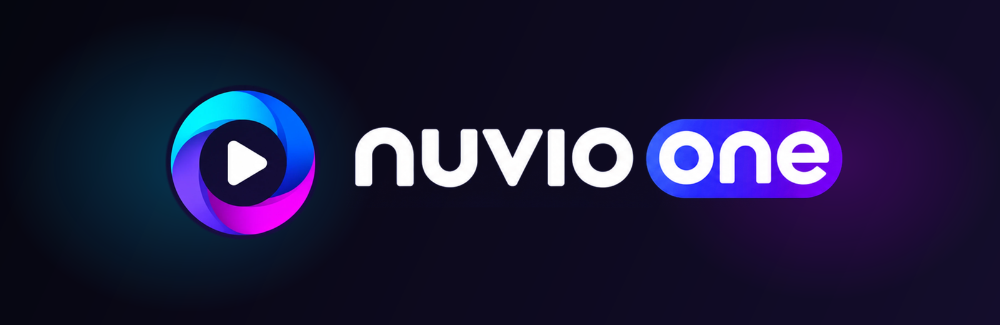

<div align="center">



# Nuvio One Desktop

**Movies and shows, Live TV, sports, YouTube and music in one app for Windows.**

[](https://github.com/zoga2o3-ops/Nuvio-One-Desktop/releases)
[](https://github.com/zoga2o3-ops/Nuvio-One-Desktop/releases)
[](LICENSE)


[What is it](#what-is-it) · [What you get](#what-you-get) · [Install](#install) · [Getting started](#getting-started) · [Updates](#updates) · [Credits](#credits)

</div>

---

> **Beta software.** Expect bugs, rough edges and changes between releases. Please report what you find.
>
> This app **does not provide any content, playlists or streams.** You bring your own sources.

## What is it

Nuvio One Desktop is a Windows app built on **Nuvio Desktop**, with four parts in one:

1. **[Nuvio](https://github.com/NuvioMedia/NuvioDesktop):** home, search, library, addons, collections, Trakt and Simkl, your Nuvio account, downloads and Nuvio's player.
2. **Live TV:** M3U, Xtream and Stalker portal sources, a guide, catch-up, recordings, multiview and On Demand, from [NuvioPlusIPTV](https://github.com/homelessbrian/NuvioPlusIPTV) by homelessbrian.
3. **OneTube:** a YouTube section of its own, played in the same player. It is not a launcher and not a web view, and you can browse it without an account.
4. **Music:** YouTube Music, your own music server, local files, playlists, lyrics and music videos.

It is the desktop companion to **[Nuvio One](https://github.com/zoga2o3-ops/Nuvio-One)** for Google TV, Android TV and Fire TV, and **[Nuvio One M](https://github.com/zoga2o3-ops/Nuvio-One-M)** for Android phones and tablets.

---

## What you get

### Nuvio core
- Home, Search, Library and title details.
- Addons, debrid services and collections.
- Trakt, Simkl and MDBList.
- Nuvio account, profiles and watch progress.
- Continue watching.
- Downloads.
- Trailers.
- TMDB artwork, ratings and metadata.

### Windows desktop
- Native Windows app, not a browser wrapper.
- MSI installer and portable build.
- In-app updater from GitHub releases.
- Native mpv player.
- Picture-in-picture.
- Fullscreen with exit and close.
- Subtitle styling: size, font, colours, outline, shadow and position.
- Playback speed.
- Audio and subtitle track selection.
- Keyboard shortcuts.
- 4K-aware scaling and a responsive layout.
- Mini player.
- Anime upscaling.
- Send a debug report from **Settings → About** (redacted, same support channel as the TV and mobile apps).

### Live TV
- M3U playlists, Xtream Codes logins and Stalker (Ministra) portals.
- Xtream server addresses accept `host:port` or a pasted `get.php?username=…&password=…` link; the login is filled from the link.
- Stalker portals use the MAC address your provider supplied and load the portal's own guide.
- XMLTV guide data, with several playlists and guides merged.
- Imported playlists are listed in **Settings → Live TV → Sources**.
- Channel groups, favourites, recents and search.
- Guide grid and channel list.
- Hide, rename, renumber and reorder channels and groups.
- Parental PIN for groups.
- Catch-up replay.
- Multiview with up to four channels.
- Recording to a local folder, including from the guide.
- Play recordings made by the TV or phone on the SMB share.
- Combine an HLS recording into one MPEG-TS file, or export MP4 without re-encoding (ffmpeg).
- Movies and series from your provider in the Movies and Series tabs.
- Quality badges and programme details.
- Google Drive and Nuvio account sync of your Live TV setup.

### Sports
- Scores by day and league.
- US college sports: football, men's and women's basketball, baseball, softball, hockey and soccer.
- Show or hide each sport in Sports settings.
- My Teams.
- League tables.
- League and team pages.
- Game pages with scores and stats.
- Shows which of your channels carry a game.
- Video window on the game page.
- Multiview.

### Music
- Home, Explore, Discover, Library, Local, Downloads and Search.
- Playlists, liked songs and queue.
- Synced lyrics.
- Music videos.
- Local music files.
- Downloads and offline playback.
- Navidrome and WebDAV servers.
- Spotify playlist import.
- Last.fm scrobbling.
- Party mode.
- Integrations.
- Equalizer.
- Background playback.
- Its own YouTube sign-in, separate from OneTube.

### OneTube
- Home, Music, Gaming, News, Sports, Live, Subscriptions, History, Playlists, Shorts and Channels.
- Search with suggestions.
- Optional Google sign-in with a TV activation code.
- Channel pages and playlists.
- Up Next and autoplay.
- Chapters.
- SponsorBlock.
- DeArrow.
- Video quality and format selection.
- Playback speed.
- Captions.
- Picture-in-picture.
- YouTube watching stays on the OneTube page and out of Continue Watching.

### Accounts and sync
- Nuvio account, profiles and watch progress.
- Live TV setup through Google Drive.
- Live TV setup through the Nuvio account.
- Trakt, Simkl and MDBList.
- Music's own YouTube sign-in, separate from OneTube.

---

## Known rough edges

- Beta software: Windows 10 and 11 are the only builds published here.
- The MSI is not code-signed yet, so Windows may warn about an unknown publisher.
- Portable builds are not updated in place. The in-app updater installs the MSI.
- Live TV recordings are written to a local folder. The SMB share is for recordings made by the TV/phone, plus Combine and MP4 exports.
- One SMB share at a time; its password is encrypted with Windows DPAPI.
- MP4 export needs ffmpeg on PATH or a path set in **Recordings → Share & export**.
- Stalker portals are supported; one portal per source, with its own MAC address.

---

## Install

Download the latest build from **[Releases](https://github.com/zoga2o3-ops/Nuvio-One-Desktop/releases)**.

| Build | What it is |
| --- | --- |
| **MSI installer** | Recommended. Installs for all users and supports in-app updates. Windows will ask for permission. |
| **Portable ZIP** | Extract it and run `Nuvio One.exe`. No install; the in-app updater installs the MSI. |

It runs on **Windows 10 and 11**.

If Windows shows **"Unknown publisher"**, choose **More info → Run anyway** only if you trust the download.

---

## Getting started

1. Open the app and sign in with your Nuvio account, or skip and add addons yourself.
2. **Live TV:** open **Live TV → Add source** and add an M3U playlist, Xtream login or Stalker portal, plus a guide if you have one.
3. **OneTube:** open OneTube. Browsing and search work without an account; sign in with a TV activation code for subscriptions and history.
4. **Music:** open Music, sign in to YouTube Music, connect a Navidrome or WebDAV server, or add local files.
5. **Sports:** open Sports and pick your teams.
6. **Recordings:** open **Live TV → Recordings → Share & export** to connect the TV/phone SMB share.
7. **Updates:** open **Settings → About** and choose **Check for updates**.

---

## Updates

New versions are published on [GitHub Releases](https://github.com/zoga2o3-ops/Nuvio-One-Desktop/releases).

- The app checks for updates from **Settings → About**.
- The MSI is the update asset. The app downloads it and runs the installer.
- The MSI upgrade ID stays the same between releases, so updates install over the existing copy and keep your data.
- Portable builds are not updated in place. Install the MSI if you want in-app updates.

---

## Build from source

You need **JDK 21**. Building the MSI also needs **WiX Toolset 3.14**.

```powershell
git clone https://github.com/zoga2o3-ops/Nuvio-One-Desktop.git
cd Nuvio-One-Desktop
.\gradlew.bat :composeApp:run
```

Portable build:

```powershell
.\gradlew.bat :composeApp:createReleaseDistributable `
  "-Pnuvio.desktop.versionName=0.1.342" `
  "-Pnuvio.desktop.versionCode=342"
```

MSI build:

```powershell
.\gradlew.bat :composeApp:packageReleaseMsi `
  "-Pnuvio.desktop.versionName=0.1.342" `
  "-Pnuvio.desktop.versionCode=342"
```

The shared app uses Kotlin Multiplatform and Compose Multiplatform.

---

## Reporting bugs

Please look through the [existing issues](https://github.com/zoga2o3-ops/Nuvio-One-Desktop/issues) first, then [open a new one](https://github.com/zoga2o3-ops/Nuvio-One-Desktop/issues/new). Say which Windows version you use, what you did and what happened. For OneTube or Music problems, include the video's title or link.

Problems that also happen in Nuvio Desktop belong with [Nuvio](https://github.com/NuvioMedia/NuvioDesktop/issues).

---

## Credits

- **Nuvio** and **Nuvio Desktop** by the NuvioMedia team, which this app is built on.
- **NuvioPlusIPTV** by homelessbrian: the Live TV guide, Sports, recordings and On Demand.
- **BitChord** by [kushagrasinghx](https://github.com/kushagrasinghx/BitChord) (GPLv3): the Music section and its YouTube Music engine, ported to this app.
- **SmartTube / MediaServiceCore** by Yurii Liskov (MIT licence): the YouTube engine.
- **SponsorBlock** by Ajay Ramachandran and its community.
- **DeArrow** by Ajay Ramachandran and its community.
- **jcifs-ng** by AgNO3 (LGPL 2.1): the SMB client used for shared recordings.
- **mpv** and **compose-media-player** for the native player.
- This product uses the TMDB API but is not endorsed or certified by TMDB.

This is an unofficial fork. It is **not affiliated with or endorsed by NuvioMedia, NuvioPlusIPTV, BitChord, SmartTube, SponsorBlock, DeArrow, Google, YouTube or TMDB.**

---

## Legal

This app is a client-side player. It does not host, store or distribute any media, and it ships with no channels, playlists or content sources. Only use sources you own or are authorized to access. Nuvio's [legal and DMCA information](https://github.com/NuvioMedia/NuvioTV#legal--dmca) applies here too.

Licensed under the **GNU General Public License v3.0**, like upstream Nuvio. See [LICENSE](LICENSE). If you share a build, share its source too.
